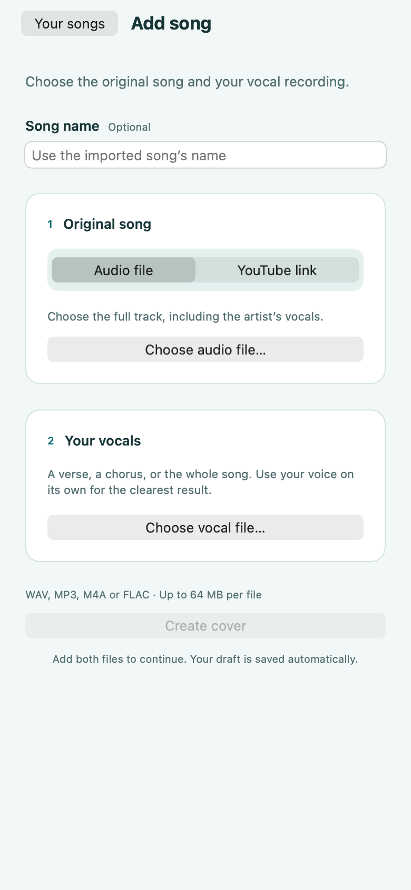
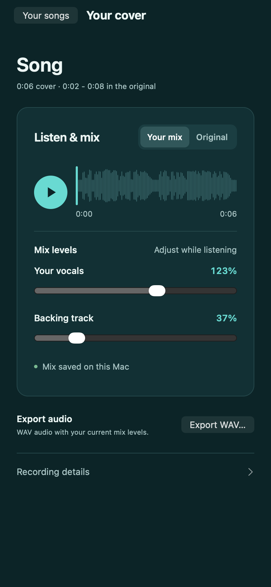

# Flowback


Your voice. The original groove.

Flowback is a Mac and web app for making covers from your own vocal recordings.

Import an original song and a recording of yourself performing its lyrics. The app separates the backing track, matches your performance to the original words, adjusts phrase timing while preserving pitch, and exports only the section you sang.

This is a local prototype with an Exact interface for macOS and web. No recording controls, voice cloning, synthesized performance, or new-lyrics mode. iOS scaffolding exists, but an iPhone cannot use this version's loopback-only processing service.

## Design and identity

Flowback shares Wisp’s calm turquoise palette, pale mint surfaces, deep teal dark mode, and compact native controls. A softly curved ribbon of sound gives the logo a little personality: tiny eyes, a quiet smile, and no extra decoration. The character appears in the library and empty state, while the rest of the interface stays focused on your music.

| Role | Light | Dark |
| --- | --- | --- |
| Page | `#F2F8F7` | `#0C2427` |
| Cards | `#FFFFFF` | `#123034` |
| Accent text | `#086B70` | `#69DAD2` |
| Primary action | `#08777B` | `#08777B` |

- [`app.tamber`](app.tamber) defines the interface’s semantic color tokens. Errors and warnings keep their platform colors.
- [`player.css`](cover_engine/studio/player.css) carries the matching palette into the embedded waveform player, comparison controls, and live mix sliders.
- [`flowback-icon.png`](assets/flowback-icon.png) is the 1254px transparent PNG used in the app and manifest. Exact derives native icon sizes from it. The [generation prompt](assets/flowback-icon.prompt.txt) is kept with the artwork.
- [`Flowback.xcassets`](modules/apple/Flowback.xcassets) supplies the native turquoise accent. Keep it and the manifest’s `theme_color` aligned with `brand.fill`.

The display name is **Flowback**. The internal identifier remains `com.rami.exact-cover`, so existing saved preferences, drafts, and library connections continue to work. Audio and model storage paths are unchanged.

<p>
  
  
</p>

These narrow-layout previews use an empty draft and synthetic test audio.

## Run

Requires the sibling `../exact2` checkout, Bun, uv, and ffmpeg. Native builds also need Exact's Xcode/Rust prerequisites. The launcher installs locked Python dependencies and starts the audio service if needed.

```sh
bun run dev:web
bun run dev:mac
```

The web app is served at `http://127.0.0.1:8893`. Keep the launcher terminal open while using either app. Closing a window does not stop the processing service. Ctrl+C stops a service started by that launcher. A separately started service is reused and left running.

The app opens to **Your songs**. Choose **Add song**, give it a name, then add the original and your vocal performance. Import WAV, MP3, M4A, or FLAC files up to 64 MiB each. For the original, you can also select **YouTube link** and **Import**. YouTube imports use [yt-dlp](https://github.com/yt-dlp/yt-dlp), support single public videos up to 20 minutes and 64 MiB, and fall back to file import when a video is unavailable or restricted. Provide the full original song, including its artist's vocals, and a clear recording of your own performance. Choose **Create cover**. If the words match multiple sections, select the intended section. Preview your cover or the corresponding original section, then choose **Export WAV**, followed by **Save WAV**. Output downloads use chunks, so uncompressed exports can exceed the upload limit.

Use **Your vocals** and **Backing track** to adjust each volume from 0% to 200% while the song plays. Changes are immediate and do not restart playback or send an audio-processing request. A small settings request saves the levels in the background. At 100%, the track uses the automatic balance; 0% mutes it. Switching to **Original** keeps your place. Moving a volume slider switches back to your cover so you hear the change.

The player loads aligned tracks once and automatically saves your levels with this cover version on the Mac. Its status confirms the save or offers a retry. Unsaved changes are also kept locally for recovery. Existing covers may take a moment to prepare those tracks the first time. **Export WAV** mixes the cached tracks with your current levels; **Save WAV** saves that export. Changing a level invalidates a previously prepared WAV. Peak protection can reduce the overall output at high levels while preserving the requested balance. Exports are immutable, so preparing a new one cannot overwrite a download in progress.

The library is the home screen, including covers made before this feature was added. Each imported original groups its vocal takes into one song row. Search by song name or vocal filename, then select a song to open its takes and player. **Your songs** returns to the library. The waveform uses the aligned audio; playback and volume controls resize to narrow windows. **Recording details** expands the source filenames and processing notes. Opening a saved take restores its files, matched section, and mix levels without repeating separation or alignment. The Mac app and web app use the same library and saved settings when connected to the same local engine.

### Multiple takes and practice analysis

Choose **Add take** inside a song to upload another performance and optionally name it. The original song is reused. Each take keeps its own volume settings, exports, and analysis. The Add song draft and each song's Add take draft have separate storage, so unfinished imports survive reopening without replacing saved covers. Switching takes preserves your position in the original song when their excerpts overlap; press Play to continue listening.

Practice analysis measures the original recording before the mix adjusts timing:

- **Recognized word agreement:** how closely the two machine transcripts match. This is not an articulation or pronunciation grade.
- **Word timing difference:** median word-start difference in milliseconds, with a constant recording-start offset removed.
- **Relative pace:** 100% means the same overall pace as the reference excerpt.
- **Pitch movement difference:** contour differences in semitones after allowing a different vocal register.
- **Observed pitch span:** the pitch spread in this excerpt, shown alongside the reference. This is not your full vocal range.

Sort takes by one measurement at a time. Different sections and unavailable measurements are identified rather than ranked as poor performances. Expand the evidence to inspect transcripts, word timing, pitch movement when measurable, and raw vocal excerpts. Playing a raw excerpt pauses the mixed track. Analysis failures do not prevent listening or exporting, and changing volume does not rerun analysis.

Pitch is unavailable when too little reliable voiced audio is detected, which can happen with rap, noisy recordings, or separation artifacts. Recognition can mishear both voices. There is no overall talent score, rhyme-quality grade, or claim that these numbers are validated measures of articulation improvement. The [research report](docs/research/vocal-assessment.md) compares existing systems, defines the measurements, and describes the validation needed for stronger claims.

Your audio stays on this Mac. The first processing job downloads pretrained model weights from their upstream hosts. Imports, intermediate audio, analysis, and finished exports persist under `~/.local/share/exact-cover`; model weights persist under `~/.cache/exact-cover/models`. Source files are never modified. There is no automatic cleanup yet.

## Architecture

- `app.contract`: library, add-song form, and cover detail with processing, match selection, playback, and export.
- `app.ts`: Exact file transport, local session persistence, and service requests.
- `cover_engine/server.py`: local HTTP API and persistent serial job queue.
- `cover_engine/youtube.py`: validated single-video imports with size and time limits.
- `cover_engine/live.py` and `cover_engine/studio/`: cached aligned tracks, synchronized Web Audio playback, and matching WAV exports.
- `cover_engine/pipeline.py`: model orchestration and saved analysis.
- `cover_engine/assessment.py`: raw-performance measurements and evidence, with explicit abstention.
- `cover_engine/assessments.py`: independent persistent analysis queue, cache, and bounded raw-vocal playback.
- `cover_engine/alignment.py`: subsequence lyric matching and phrase timing.
- `cover_engine/audio.py`: decoding, pitch-preserving timing changes, mixing, and section export.

The shared boundary is documented in [API.md](API.md). The engine does not depend on Exact. A future hosted service can serve web and iOS clients, with authentication, upload policy, and deployment designed separately.

## Models and dependencies

The initial separator is `UVR_MDXNET_KARA_2.onnx` through [Audio Separator](https://github.com/nomadkaraoke/python-audio-separator). Transcription uses the multilingual `small` model through [Faster Whisper](https://github.com/SYSTRAN/faster-whisper). Practice pitch estimation uses the full [torchcrepe](https://github.com/maxrmorrison/torchcrepe) model with deterministic decoding and explicit evidence gates. Pitch-preserving timing uses [Pedalboard](https://github.com/spotify/pedalboard), which includes Rubber Band. The Python lock pins a compatible dependency set; `librosa<1` and `av<17` avoid incompatibilities observed during real model integration.

Optional environment settings:

| Variable | Default |
| --- | --- |
| `EXACT_COVER_DATA_DIR` | `~/.local/share/exact-cover` |
| `EXACT_COVER_MODEL_DIR` | `~/.cache/exact-cover/models` |
| `EXACT_COVER_SEPARATOR_MODEL` | `UVR_MDXNET_KARA_2.onnx` |
| `EXACT_COVER_WHISPER_MODEL` | `small` |
| `EXACT_COVER_WHISPER_DEVICE` | `cpu` |
| `EXACT_COVER_WHISPER_COMPUTE` | `int8` |

These dependencies and model weights have their own licenses. Pedalboard is GPL-licensed; distributing a proprietary app with this engine needs a compatible licensing strategy. This prototype does not grant rights to redistribute source songs or recordings.

## Verification and current limits

```sh
uv run --extra models pytest -q
uv run --extra models ruff check cover_engine tests
uv run --extra models ruff format --check cover_engine tests
bun run typecheck
bun test tests/*.test.js
bun exact.mjs test web
bun exact.mjs test macos
```

Set `CHROME` to an installed Chromium executable if Exact cannot find Chrome. Tests use isolated temporary data. The HTTP tests inject an engine and do not measure model accuracy. The audio tests measure pitch retention, section boundaries, repeated-section selection, and preservation of input files.

For the multiple-take UI tests, start the isolated synthetic fixture in another terminal:

```bash
uv run --extra models python tests/practice_fixture.py --port 8898
EXACT_BACKEND_ORIGIN=http://127.0.0.1:8898 bun exact.mjs test web app.test.contract tests/practice.test.contract
EXACT_BACKEND_ORIGIN=http://127.0.0.1:8898 bun exact.mjs test macos app.test.contract tests/practice.test.contract
```

The fixture generates harmonic and noisy audio with known word timestamps, then runs the actual measurements, rendering, playback, and persistence service. It does not use anyone's recordings. Its data lives under `.exact/practice-fixture`; use `--root` with a new directory for a fresh fixture after manually adding takes. `--check-only` checks the fixture's API, raw excerpts, preview, export, and ranking without starting a server.

Word timestamps from transcription are estimates, particularly on fast rap or sustained singing. Matching requires at least three distinct words and substantial lyrical overlap. Repeated lyrics may need your choice. Alignment preserves continuous vocal audio between phrases, including breaths and unrecognized sounds, with short opening and closing handles. Audio outside those outer handles is omitted from the section. Phrase stretching outside a 0.5-2 speed ratio is refused. Separation can leave traces of the original singer, and timing adjustments can still introduce artifacts. The mix does not provide mastering, pitch correction, or manual timing editing.

A successful synthetic integration run does not establish musical quality. Listening with real song and vocal recordings remains necessary to judge each cover.

The real separator and transcription models were exercised with synthetic speech over a backing track, including a partial performance and repeated sections. Both Mac and web import, processing, preview controls, and WAV export were exercised. Layout checks cover narrow and desktop sizes, light/dark appearance, and large text. These checks establish the file-processing workflow, not production readiness or musical accuracy.
